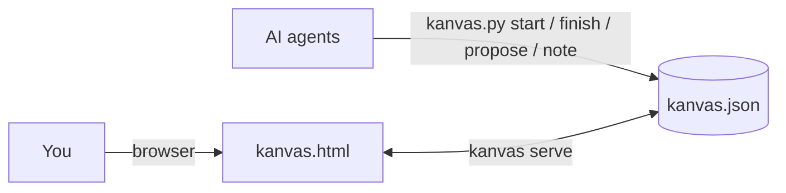

<h1>
<picture>
<source media="(prefers-color-scheme: dark)" srcset="img/kanvas-dark.svg">

</picture>
</h1>

A task board you share with your AI coding agents. Agents plan and report through a small CLI; you approve, steer and review in an interactive board in your browser.

One JSON file, one Python script, one HTML page. No accounts, no build step, no dependencies.


## Why

AI agents do their best work in a terminal, but a project needs a plan that outlives a single chat: what is left, what depends on what, what was decided and why. Kanvas keeps that plan in `kanvas.json` next to your code, where you and any number of agents work on it together.

- **Delivery, not wishful statuses.** A task needs a product definition before To do, a technical plan before Doing, two review gates before Done, and deployment evidence before Production. YOLO automates attention, never those gates.
- **Agents cannot break the board.** They change it through `kanvas.py`, which enforces the workflow and rejects invalid moves with a clear message.
- **Live.** Agent changes appear in the browser within a second, and your edits are on disk immediately for the agent's next command.
- **Agent-agnostic.** Claude Code, Codex, Cursor, Gemini CLI, OpenCode, GitHub Copilot, or anything that runs shell commands. Use several at once; notes record who did what.
- **Git-friendly.** The board is plain, stably formatted JSON. Commit it with the code and your history shows how the plan evolved.

## Quick start

### The easy way: let your agent set it up

The easiest way to start is just to open Claude Code, Codex, Cursor, Gemini CLI or OpenCode in your project's folder and paste into the chat:

> Set up Kanvas in this project with `uvx kanvas-board init` (https://github.com/XMihura/Kanvas), then follow `.agents/skills/kanvas/SKILL.md` and plan the work with me on the board.

The agent should then guide you.

### Formal quickstart

Kanvas works on Linux, macOS and Windows. You need a browser and [uv](https://docs.astral.sh/uv/), which installs Kanvas and downloads Python too if your computer has none.

**1. Install uv** (once). On macOS and Linux, run this in a terminal:

```bash
curl -LsSf https://astral.sh/uv/install.sh | sh
```

On Windows, run this in PowerShell:

```powershell
powershell -ExecutionPolicy ByPass -c "irm https://astral.sh/uv/install.ps1 | iex"
```

Then close the terminal and open a new one.

**2. Install Kanvas** (once):

```bash
uv tool install kanvas-board
```

This gives you the `kanvas` command. If the terminal later cannot find it, run `uv tool update-shell` and open a new terminal.

**3. Open the board.** Go to your project's folder and run:

```bash
cd path/to/your-project
kanvas init
kanvas serve
```

`init` creates the board, `kanvas.json`, and installs the agent skill in `.agents/skills/kanvas/`: instructions for your agents and their own copy of Kanvas, so agents need nothing installed. Commit `kanvas.json` and `.agents/` with your project.

Agents that support skills pick the skill up automatically, and `init` creates an `AGENTS.md` that points the others to it. If your project already has an `AGENTS.md`, `init` leaves it untouched and, when the file does not mention the skill yet, prints this line for you to add:

```
Plan and track work on the Kanvas board; follow .agents/skills/kanvas/SKILL.md.
```

`serve` opens the board in your browser. Keep it running while you work; Ctrl+C stops it. Run `kanvas serve` in your other projects too: their boards open in the same Kanvas, each at its own address such as `http://127.0.0.1:8765/my-project/`, and the terminal is free again right away. Switch boards from the menu on the board's name, or with Shift+← and Shift+→, or keep each in a tab of its own.

**4. Ask your agent:**

> Interview me about this project and plan it on the Kanvas board.

The plan arrives as proposals. Approve the ones you want, and tell the agent to start working.

### Other ways to install and update

Try Kanvas without installing it:

```bash
uvx kanvas-board init
uvx kanvas-board serve
```

Install with pipx, or straight from GitHub without PyPI:

```bash
pipx install kanvas-board
uv tool install https://github.com/XMihura/Kanvas/archive/refs/heads/main.zip
```

Without uv, you need Python 3.8 or newer. [Download](https://github.com/XMihura/Kanvas/archive/refs/heads/main.zip) or clone this repository and run its `kanvas.py` in your project's folder; from then on, use the project's copy (type `python3` where `python` is missing):

```bash
python path/to/kanvas.py init
python .agents/skills/kanvas/kanvas.py serve
```

To update, run this, then `kanvas init` again in each project to refresh the copy its agents use:

```bash
uv tool upgrade kanvas-board
```

`kanvas status` and `kanvas serve` remind you when a project's copy differs from the installed `kanvas`: they suggest `kanvas init` when the copy is older, and `uv tool upgrade kanvas-board` when it is newer.

## How it works



Every task moves through six states. A to-do task whose dependencies are unfinished shows as blocked, and becomes ready by itself once they are done.

| State | Color and mark | Who moves it there |
|-------|----------------|--------------------|
| Proposed | purple, dashed circle | An agent proposes it |
| To do | blue, empty circle (gray and struck through while blocked) | PO + TL complete the product Grill me |
| Doing | orange, half-filled circle | Architect + senior complete the technical Grill me and start a worktree |
| Review | pink, three-quarters-filled circle | The implementer finishes; an independent agent and a human review it |
| Done | green, filled circle with a check | The reviewed change is merged to `dev` |
| Production | teal, filled star | The change is merged to `main`/`master` and deployed |

The first Grill me records the outcome, needs and constraints, acceptance criteria and non-goals. The second records the architecture, implementation, tests and rollout plan. `start` also snapshots each supplied Git worktree—repository, path, branch, commit and uncommitted-change flag. Review then has two explicit, independent gates: an agent PR review and a manual review. A dev merge and a production promotion each require their own evidence.

## The board


- **Graph view.** One swimlane per group, laid out by dependency depth, flowing left to right or top to bottom (switch under Display, or press `L`). The automatic layout orders the cards for fewer crossings and straighter arrows, and arrows that skip levels run between cards. A swimlane with three or more finished tasks folds them into one stub, such as "8 done": click it to show them, and again to fold them. Arrows from folded tasks are left out, since a finished dependency holds nothing up, and a task you open from a link, the bell or search shows even when its swimlane is folded. Set the card order to Manual under Display (or press `M`) to order the cards yourself: drag a card up or down within its level, or into another swimlane to change its group, and drag a swimlane by its name to reorder the groups. Your order is saved in `kanvas.json`, and right-clicking empty space offers to start from the automatic order. The spacing slider under Display, or `[` and `]`, compresses or extends the space between dependency levels. Hover or select a task to highlight everything it depends on and everything waiting for it. A dependency that another dependency already implies (C needs A and B, and B needs A) stays in the file but is drawn only while A or C is selected, as a dashed arrow. Each card has a dot on its incoming and outgoing side: drag one onto another card to add a dependency in that direction (cycles are refused). Click an arrow to open or remove the dependency.
- **Board view.** Kanban columns by state. Forward transitions open the required Grill me, review or delivery-evidence dialog; dragging cannot bypass a gate. On a phone, one column fills the screen, and a row above the columns gives every state with its count; tap one to go to its column.
- **New tasks.** Choose what a new task depends on and what it blocks by searching, or with **Pick on graph**: click cards to add or remove them, then press Done (or Enter), or Cancel (or Escape) to keep the earlier choice. Choices that would create a cycle are dimmed, with the reason on hover.
- **Task panel.** Alongside the task and notes, it shows the approved product definition, construction plan and Git worktrees, both review gates, and dev/production delivery evidence.
- **Questions from agents.** When an agent needs your answer to go on, it runs `ask` and asks in its chat. Its card turns from Doing to **Waiting for you** and shows the question, a toast announces it, the bell lists it above the work to review, across every open board, and the browser tab's title counts the agents waiting, as in `(1) My project · Kanvas`. You reply in the agent's chat, and the card goes back to Doing with the agent's next note. If that chat is gone, Dismiss in the task panel clears the question.
- **Right-click menus.** On a card: state actions, a new task that depends on it or blocks it, adding and removing dependencies, copying the ID, deleting. On an arrow (left or right click): the two tasks it connects are highlighted and shown in the menu; click either one to open it, or remove the connection. On empty space: a new task in that group, a new group, or deleting that group (its tasks stay without a group unless you choose to delete them too).
- **Undo and redo.** Ctrl+Z undoes your last change in the browser, Ctrl+Shift+Z or Ctrl+Y redoes it, and the arrows next to New task do the same. On a Mac, these and the page's other Ctrl shortcuts use ⌘, as the page shows. The toast that confirms a change has an Undo button for that change. Changes agents made in the meantime are kept: an undo only touches what your change touched, and refuses if an agent has changed that since. Inside a text field, Ctrl+Z undoes typing as usual.
- **YOLO.** "YOLO up to here…" selects a dependency chain for autonomous attention. It never creates product definitions, approves reviews, merges to dev or promotes to production. The task carries a YOLO tag and covered work a lightning icon; the same menu turns it off.
- **Everything else.** Filter by state, search (press `/`), hide finished work, groups with their own ID prefixes (from the menu on the board name), light, dark or system theme, keyboard shortcuts (press `?`), arrow keys to move from card to card and Enter to move into its panel (Tab goes round the panel, Escape comes back out), and links: `#TR-02` in the URL opens that task.


There are three ways to open it:

| | |
|---|---|
| `kanvas serve` | Any browser, live two-way sync. Concurrent changes from agents and the browser merge automatically. |
| Open `kanvas.html` directly | The project has a copy in `.agents/skills/kanvas/`. In Chrome or Edge, choose your `kanvas.json` and the page reads and writes it in place, with live updates. Other browsers edit a copy in the tab; **Save** downloads it. |
| `kanvas export` | A single self-contained, read-only HTML snapshot to share or attach to a pull request. |

## On your phone

Kanvas can open your boards on your phone, or on another computer, through [Tailscale](https://tailscale.com), a free private network between your own devices.

1. Install Tailscale on the computer that runs Kanvas and on your phone ([downloads](https://tailscale.com/download)), and sign in to the same account on both.
2. In the board, choose **Open on your phone…** in the menu on the board's name, then **Open to my phone**.
3. Scan the QR code with the phone's camera.

`kanvas serve --tailscale` opens Kanvas to your phone from the start and prints the QR code in the terminal. Under the QR code are the board's address by the computer's Tailscale name, such as `http://my-computer.tail1234.ts.net:8765/my-project/`, and by its Tailscale IP, in case the name does not resolve. Your other open boards are there too.

Kanvas listens only on this computer and on its Tailscale address, so your home or café network cannot reach it, and it answers only to this computer's own names. It has no password: anyone on your Tailscale network can open and edit your boards. Opening new boards, and opening Kanvas to phones, stay with the computer.

### If the phone cannot connect

The computer's firewall is probably blocking Kanvas. Kanvas uses port 8765, or the next free one up to 8784; the dialog shows which. Allow those ports from Tailscale's addresses (`100.64.0.0/10`) only:

| System | What to do |
|--------|------------|
| Windows | The first time, Windows asks whether Python may communicate on networks: allow it. If you missed that, run in PowerShell as administrator: `New-NetFirewallRule -DisplayName "Kanvas over Tailscale" -Direction Inbound -Protocol TCP -LocalPort 8765-8784 -RemoteAddress 100.64.0.0/10 -Action Allow` |
| macOS | The firewall is off unless you turned it on. If it is on, macOS asks whether Python may accept incoming connections: choose Allow. If you missed that, add Python under System Settings > Network > Firewall > Options. |
| Ubuntu, Debian, Mint (ufw) | `sudo ufw allow in on tailscale0 to any port 8765:8784 proto tcp` |
| Fedora, RHEL (firewalld) | `sudo firewall-cmd --permanent --add-rich-rule='rule family="ipv4" source address="100.64.0.0/10" port port="8765-8784" protocol="tcp" accept'`, then `sudo firewall-cmd --reload` |
| NixOS | In your configuration: `networking.firewall.interfaces.tailscale0.allowedTCPPortRanges = [ { from = 8765; to = 8784; } ];`, then rebuild |

Then pick **Open on your phone…** again and scan.

### Keep Kanvas running

For the phone to reach your boards, Kanvas has to be running on the computer. Instead of leaving a terminal open, let it start when you log in:

```bash
kanvas service install --tailscale
```

It then runs in the background with the boards you opened before, and opens them to your phone as soon as Tailscale is connected. A board you open later with `kanvas serve` joins it and is remembered too. Leave out `--tailscale` to keep the boards on this computer only. `kanvas service status` says whether it is set up and running, and `kanvas service uninstall` removes it.

This needs Kanvas installed with `uv tool install kanvas-board`, as in [Quick start](#quick-start), so the service has a lasting command to run. On each system it uses the usual mechanism for your own programs, without administrator rights:

| System | What `service install` sets up |
|--------|------------|
| Linux | A systemd user service, `~/.config/systemd/user/kanvas.service`; `systemctl --user status kanvas` and `journalctl --user -u kanvas` show how it is doing. It starts when you log in; to start it at boot, before you log in, run `loginctl enable-linger $USER` once. On NixOS, the same command works. |
| macOS | A LaunchAgent, `~/Library/LaunchAgents/kanvas.plist`, logging to `~/Library/Logs/Kanvas.log` |
| Windows | A Task Scheduler task named `kanvas` that runs at logon without a window |

The browser's **Open to my phone** and **Stop opening to phones** are remembered the same way, so you can also change phone access from the board.

## CLI

You type `kanvas <command>`; `kanvas -h` lists the commands and `kanvas <command> -h` explains one. Agents run the same commands through the project's copy, `python .agents/skills/kanvas/kanvas.py <command>`, so cloud agents and teammates who never installed Kanvas can work on the board too. Messages name the command you typed: `kanvas ...` for the installed command, `python .agents/skills/kanvas/kanvas.py ...` for the project's copy.

| Command | Purpose |
|---------|---------|
| `status` | Overview: doing, waiting for review, ready, blocked, proposed, problems |
| `ready` / `blocked` | What can start now / what waits on what |
| `show ID` | Details, dependencies and notes |
| `list [STATE or GROUP]` | Tasks by group, optionally filtered |
| `start ID -m PLAN [--worktree PATH ...]` | To do to doing after the technical Grill me; records the plan and Git snapshots |
| `finish ID -m SUMMARY` | Doing to review; creates pending agent and manual review gates |
| `agent-review ID (--approve\|--changes) -m FINDINGS` | Independent implementation/PR review; changes return the task to Doing |
| `pause ID [-m NOTE]` | Doing back to to do |
| `note ID TEXT` | Append a note; descriptions stay as the human wrote them |
| `ask ID QUESTION` | Show that the agent waits for your reply in its conversation, until its next note |
| `propose GROUP TITLE [DESC] [--deps ID ...]` | Propose a task |
| `add-group NAME [--prefix XX]` | Create a group |
| `batch` | Propose many groups and tasks from JSON on stdin |
| `depend ID ON [ON ...]` | Add dependencies |
| `edit ID [--title T] [--group G] [--desc D]` | Revise a proposal that is not approved yet |
| `withdraw ID [ID ...]` | Delete proposals that are not approved yet |
| `undepend ID ON [ON ...]` | Remove dependencies from a proposal |
| `check` | Validate the board; exit code 1 on errors |
| `serve [--port N] [--host H] [--tailscale]` | Open the board in the browser; when Kanvas already runs for another project, open the board there and return. In a project without a board, offer to create one first. `--tailscale` also opens the boards to your phone over Tailscale |
| `serve --saved` | Serve only the boards open last time, without a project of its own; what `service` runs |
| `service install [--tailscale]` / `uninstall` / `status` | Start Kanvas when you log in, so your boards are always open; `--tailscale` also opens them to your phone |
| `init [DIR]` | Set up Kanvas in a project, or refresh the agents' copy after an update |
| `import FILE.canvas` | Migrate a Kanvas 0.x Obsidian board |
| `export [FILE.html]` | Write a read-only snapshot |

`init` creates `kanvas.json` and installs the agent skill in `.agents/skills/kanvas/` (a copy of `kanvas.py`, `kanvas.html` and `SKILL.md`), and a copy of `SKILL.md` in `.claude/skills/` for Claude Code, which reads skills only from there. Codex, Cursor, Gemini CLI, OpenCode and GitHub Copilot read `.agents/skills/`. When the project has no `AGENTS.md`, it creates one that points agents to the skill. Run without a folder, it picks the folder that already holds a board (the current folder or one above it), else the top folder of the git repository, else the current folder; `kanvas init .` keeps the current folder, for one board per subproject. Apart from the skill files it installs, it never modifies an existing file.

In a project without a board, `serve` asks whether to create one, then opens it. Without a person at the terminal, it fails with a message naming `kanvas init`.

One Kanvas serves the boards of all your projects. The first `serve` starts it and keeps running; a `serve` in another project finds it, opens its board there and returns. Each board's address is named after its project folder, and `http://127.0.0.1:8765/` lists the open boards. Kanvas remembers that list, and whether it was open to phones, in `boards.json` in your user folder (`~/.local/state/kanvas/` on Linux, `~/Library/Application Support/Kanvas/` on macOS, `%LOCALAPPDATA%\Kanvas\` on Windows), so the next start reopens them. A board whose file is gone is dropped from the list.

Text arguments also accept `--stdin` and `--file PATH`, read as UTF-8 on every platform, which is the reliable way to pass multi-line or non-ASCII text from any shell. Notes and proposals are signed with `--as NAME` or the `KANVAS_AGENT` environment variable. The CLI finds `kanvas.json` in the current directory or any parent; `--board PATH` or `KANVAS_BOARD` point elsewhere.

Writes take a short lock and replace the file atomically, so several agents and the browser can work at the same time without losing changes.

## File format

```json
{
  "kanvas": 1,
  "title": "Learning to fly",
  "groups": [
    {
      "id": "TR",
      "name": "Training"
    }
  ],
  "tasks": [
    {
      "id": "TR-02",
      "title": "Train the first policy",
      "state": "review",
      "group": "TR",
      "deps": ["TR-01", "SM-03"],
      "desc": "- [x] Passes every gate on most random courses\n- [x] Copes with wind up to 8 m/s",
      "notes": [
        {
          "at": "2026-10-25T08:20:00Z",
          "by": "codex",
          "text": "The policy flies the course on its own: 92 of 100 random courses through every gate."
        }
      ]
    }
  ]
}
```

States are `proposed`, `todo`, `doing`, `review`, `done` and `production`; blocked is computed. Optional `definition`, `work`, `review` and `delivery` objects contain the gate evidence. `"yolo": true` selects the task and its dependencies for autonomous attention but does not bypass gates. The CLI and browser preserve unknown fields and write the same canonical formatting, so diffs show only real changes. See [`examples/drone.json`](examples/drone.json) for a complete board.

## Migrating from Kanvas 0.x (Obsidian)

```bash
kanvas init
kanvas import Project.canvas
```

Card colors become states, groups come from the canvas groups, arrows become dependencies, and existing task IDs are kept. The `.canvas` file is left untouched. Once you are happy with the result, delete `Project.canvas`, `canvas-tool.py`, `RULES.md`, the Kanvas instructions in `CLAUDE.md` / `AGENTS.md`, and the `.obsidian/plugins/canvas-watcher` plugin.

## Development

```bash
python -m unittest discover -s tests -v
```

The suite is standard library only; one test also runs the browser's serializer under Node.js when it is installed, to check that both sides write identical files. Contributor notes are in [AGENTS.md](AGENTS.md).

## License

MIT
